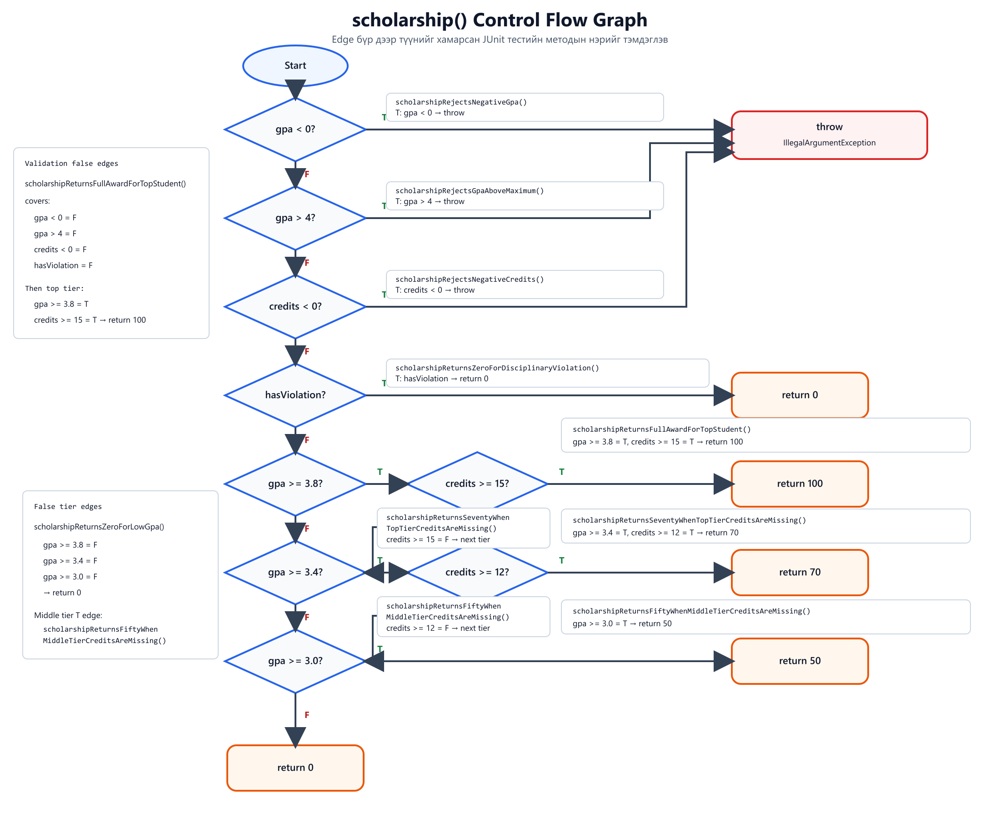

# Лаборатори 9 — JaCoCo код хамралт

- Нэр: Мөнхбаяр
- Оюутны код: B242270045

## Орчин

```text
java version "17.0.12" 2024-07-16 LTS
Java(TM) SE Runtime Environment (build 17.0.12+8-LTS-286)
Java HotSpot(TM) 64-Bit Server VM (build 17.0.12+8-LTS-286, mixed mode, sharing)
```

```text
Apache Maven 3.10.0 (c43a36b8d67be7e0805a411bc0898af1a51f5472)
Maven home: C:\Users\Dell G15\Desktop\Shutis\juniorYear\ProgrammingQuality\Lab001\.tools\apache-maven-3.10.0
Java version: 17.0.12, vendor: Oracle Corporation, runtime: C:\Program Files\Java\jdk-17
Default locale: en_US, platform encoding: Cp1252, time zone: Asia/Ulaanbaatar
OS name: "windows 11", version: "10.0", arch: "amd64", family: "windows"
```

## A — Happy path тест

Эхний 5 хэвийн урсгалын тест бүгд амжилттай ажилласан. `results/jacoco-A.csv`-ийн дагуу Line хамралт 14/25 буюу 56.0%, Branch хамралт 18/41 буюу 43.9% байв.

Тайланд оролтын шалгалт, `gpa()`-ийн хоосон утгын шалгалт, `scholarship()`-ийн доод шатны нөхцөлүүд шар харагдсан. `letterGrade()`-ийн C/D/F зам, `gpa()`-ийн C/D/F switch зам, exception мөрүүд болон 70/50/0 хувийн тэтгэлгийн мөрүүд улаан байв.

## B — CFG ба 100% branch хамралт

Оролтын алдаа, бүх үсгэн дүн, switch-ийн default зам, `scholarship()`-ийн богино холболттой нөхцөл бүрийг тусдаа тестээр шалгав. Нийт 19 тест шаардагдсан. `results/jacoco-B.csv`-д `BRANCH_MISSED = 0`, `BRANCH_COVERED = 41`, `LINE_MISSED = 0`, `LINE_COVERED = 25` гарсан тул Branch болон Line хамралт хоёул 100% болсон.



## C — Давталтын зааг

`gpaRejectsEmptyScores()`, `gpaHandlesSingleScoreLoopBoundary()`, `gpaHandlesManyScoresLoopBoundary()` тестүүдээр давталтыг 0, 1, 2+ удаа ажиллуулах тохиолдлыг шалгав. Мөн `gpaRejectsNullScores()` нь null оролтыг тусад нь шалгана.

Эдгээр тест өмнө нь 100% болсон хамралтын хувийг өсгөхгүй. Гэхдээ хамралтын тоо оролтын хэмжээний зааг дээрх буруу үр дүн, exception болон давталтын алдааг зөв эсэхийг батлахгүй тул зааг бүрийг тусад нь шалгах хэрэгтэй.

## D — Зааг утгын алдаа

`letterGradeReturnsDAtLowerBoundary()` тестийг нэмэхэд `expected: <D> but was: <F>` алдаатай унав. Шалтгаан нь D дүнгийн нөхцөл `score > 60` байсан тул яг 60 оноог F болгож байв. Нөхцөлийг `score >= 60` болгож зассан бөгөөд засварыг `Fix letterGrade boundary: 60 belongs to D` commit-д оруулав. Эцсийн 28 тест бүгд ногоон болж, `results/jacoco-final.csv`-д Branch 41/41, Line 25/25 буюу хоёул 100% гарсан.

Branch хамралт 100% байсан ч 60 онооны алдаа үл үзэгдсэн. `score > 60` болон `score >= 60` хоёр ижил true/false салаа үүсгэдэг. Өмнөх тестүүд хоёр салааг дайрсан боловч яг 60 гэсэн зааг утгыг шалгаагүй. Хамралт нь ямар код, салаа ажилласныг хэмждэг болохоос үр дүн спецификацитай зөв таарсныг батлахгүй. Тиймээс хамралтыг зааг утгын тест болон зөв oracle-той хамт ашиглах шаардлагатай.

## AI ашиглалт

Codex-ийг даалгаврын заавар унших, тестийн хувилбарууд төлөвлөх, үр дүнг шалгахад ашигласан.
